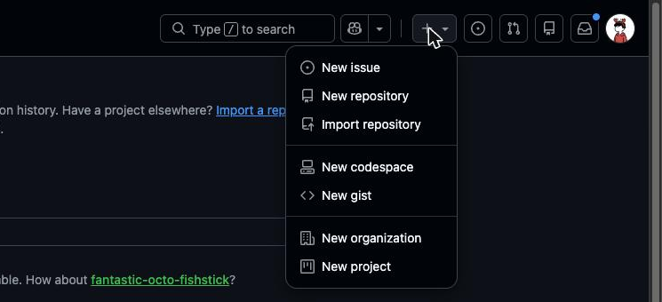
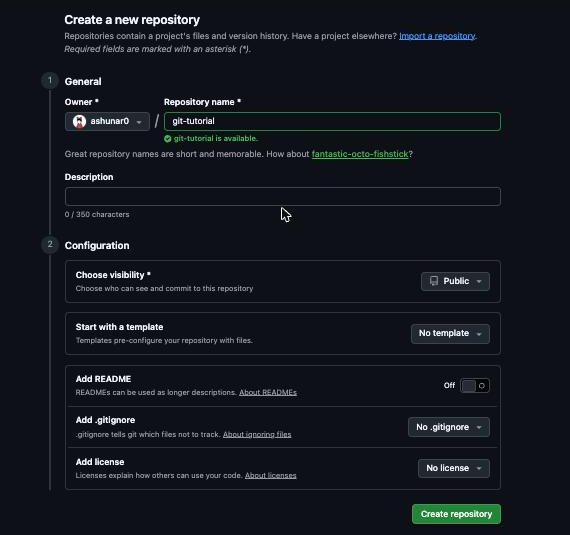
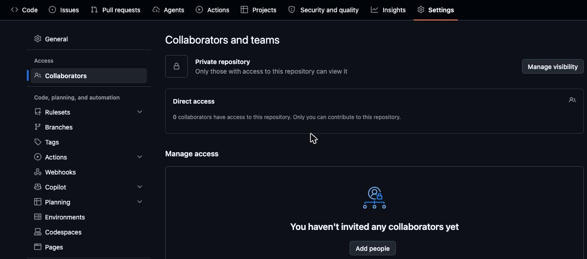
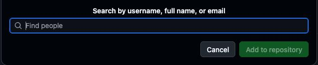
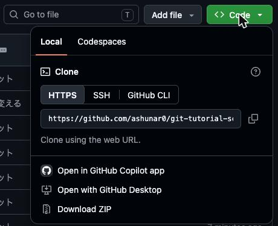
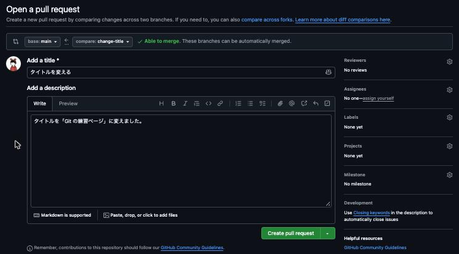
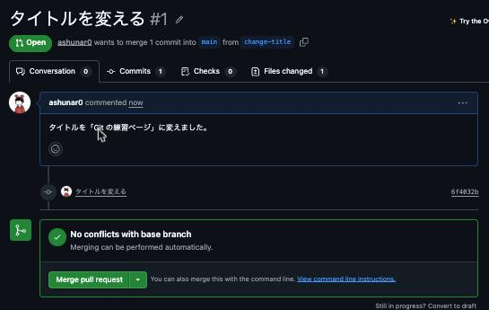
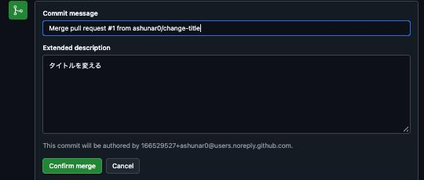
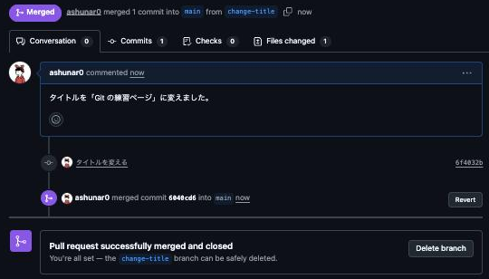

## 普段のくりかえし

```plaintext
git checkout main → git pull origin main → uv sync
  ↓
git checkout -b ブランチ名
  ↓
コードを変更する（パッケージが必要なら uv add）→ uv run で確かめる
  ↓
git add . → git commit -m "メッセージ" → git push origin ブランチ名
  ↓
GitHub で PR を作成する → ほかのメンバーがマージ
```

- `main` を直接変更しない。必ずブランチを作成して、そこで作業する
- 迷ったら `git status`

## Git と GitHub

### Git

- コードの変更の履歴を残す道具
- ゲームのセーブデータと同じ。「ここまでできた」という時点を記録しておいて、壊したらそこまで戻れる
- この 1 回分の記録を**コミット**と呼ぶ
- Git で管理しているフォルダを**リポジトリ**と呼ぶ

### GitHub

- コードを置いておくクラウド。Google ドライブにファイルを置くのと同じで、自分のパソコンの外に置く
- Git の履歴（セーブデータ）ごと置ける。パソコンが壊れても、GitHub から取得すれば元に戻せる
- チームのメンバーは、GitHub に置いたコードを取得して、それぞれ変更して、また GitHub に送る

## プロジェクトを始める

1 つのプロジェクトで最初の 1 回だけ。チームのだれか 1 人がやる。

### プロジェクトを作成する

```plaintext
uv init プロジェクト名
```

```bash
uv init my-project
cd my-project
uv run main.py
```

```plaintext
Using CPython 3.14.0
Creating virtual environment at: .venv
Hello from my-project!
```

- プロジェクトを置きたいフォルダで打つ
- `uv init` が中で `git init` も実行するので、作成した時点でリポジトリになっている

### git init

「今いるフォルダを、Git で管理し始める」

```bash
git init
```

- uv を使わずに作成したフォルダでだけ打つ

### 最初のコミット

```bash
git add .
git commit -m "最初のコミット"
```

```plaintext
[main (root-commit) 250d6b5] 最初のコミット
 6 files changed, 32 insertions(+)
```

### GitHub にリポジトリを作成する

- 右上の「+」→「New repository」



- 「Repository name」にプロジェクト名
- ほかは何も変えずに「Create repository」。README などを追加すると、あとの `git push` で止まります



### GitHub に送る

「送り先として、GitHub のリポジトリを登録する」

```bash
git remote add origin https://github.com/ユーザー名/my-project.git
```

- URL は、GitHub でリポジトリを作成したあとの画面に表示される

「`main` のコミットを、GitHub に送る」

```bash
git push origin main
```

- 送ったあとに GitHub のページを再読み込みすると、ファイルが表示される

### メンバーを招待する

- リポジトリのページの「Settings」→ 左の「Collaborators」→「Add people」
- パスキーやパスワードを聞かれたら、自分のもので認証する



- メンバーの GitHub のユーザー名を入れて「Add to repository」



- メンバーには GitHub からメールが届く。「View invitation」→「Accept invitation」で参加する

## プロジェクトに参加する

1 つのプロジェクトで最初の 1 回だけ。招待されたメンバーがやる。

### git clone

「GitHub のリポジトリを、手元に持ってくる」

```plaintext
git clone リポジトリのURL
```

```bash
git clone https://github.com/ユーザー名/my-project.git
cd my-project
uv sync
uv run main.py
```

- URL は、リポジトリのページの緑の「Code」ボタンを押すと表示される。右のボタンでコピーできる



- `.venv` は GitHub に置いていないので、`uv sync` で作成する

## 変更して main に入れる

### ブランチ

```plaintext
main                    o---o-----------o   <- マージしたあと
                             \         /
feature/change-message        o---o---      <- ここで作業する
```

- `main` から枝分かれさせた、作業用の場所
- ブランチの中で変更しても、`main` は変わらない

### git pull

「GitHub の `main` の変更を、手元の `main` に取得する」

```bash
git checkout main
git pull origin main
uv sync
```

```plaintext
Updating 250d6b5..032986f
Fast-forward
 main.py | 2 +-
 1 file changed, 1 insertion(+), 1 deletion(-)
```

- ブランチを作成する前に打つ。古い `main` から枝分かれさせない
- `main` に移ってから `pull` する
- ほかのメンバーがパッケージを追加しているかもしれないので、`uv sync` も打つ

### git checkout -b

「`feature/change-message` というブランチを作成して、そこに移る」

```plaintext
git checkout -b ブランチ名
```

```bash
git checkout -b feature/change-message
```

```plaintext
Switched to a new branch 'feature/change-message'
```

- `-b` を付けないと、作成せずに移るだけ（`git checkout main` で `main` に戻る）

### ブランチの名前

```plaintext
種類/何をするか
```

| 種類 | 使うとき | 例 |
|---|---|---|
| `feature/` | 機能を追加する | `feature/add-csv-export` |
| `fix/` | 不具合を直す | `fix/loss-nan` |
| `docs/` | ドキュメントだけを変える | `docs/update-readme` |
| `refactor/` | 動作を変えずにコードを整理する | `refactor/split-train-script` |

- 英語の小文字で書く。単語の間は `-` でつなぐ。スペースと日本語は使わない
- 「何をするか」は動詞から始める（`add-` `fix-` `update-` `remove-`）
- 名前を見て中身が分かるようにする。`test` `tmp` `yamada` のような名前にしない
- 1 つのブランチでやることは 1 つ。別のことをするときは、`main` に戻って新しいブランチを作成する

### git branch

「ブランチの一覧と、今いるブランチを見る」

```bash
git branch
```

```plaintext
* feature/change-message
  main
```

- `*` が付いているのが今いるブランチ

### git status

「今の状態を見る」

```bash
git status
```

```plaintext
On branch feature/change-message
Changes not staged for commit:
	modified:   main.py
```

- 困ったらとりあえず打つ。打っても何も変わらない
- `.venv` は出てこない。`.gitignore` に書いてあるファイルは Git が無視する

### git add

「変更したファイルを全部、次のコミットに入れる」

```bash
git add .
```

- `.` は「このフォルダの中の全部」
- 打っても何も出ない。`git status` で確かめると、緑の `new file:` や `modified:` に変わっている

### git commit

「ここまでの変更を、〇〇というメッセージでコミットする」

```plaintext
git commit -m "メッセージ"
```

```bash
git commit -m "メッセージを変える"
```

```plaintext
[feature/change-message 032986f] メッセージを変える
 1 file changed, 1 insertion(+), 1 deletion(-)
```

- メッセージには、何をしたかを書く。日本語でいい
- `git add` したものだけがコミットに入る

### git log

「これまでのコミットを一覧で見る」

```bash
git log --oneline
```

```plaintext
032986f (HEAD -> feature/change-message) メッセージを変える
250d6b5 (main) 最初のコミット
```

- 新しいものが上
- 左の英数字はコミットごとの番号

### git push

「`feature/change-message` のコミットを、GitHub に送る」

```plaintext
git push origin ブランチ名
```

```bash
git push origin feature/change-message
```

- `main` ではなく自分のブランチ名を書く

### プルリクエスト

- 「このブランチの変更を、`main` に入れてください」という頼み。略して **PR**
- push したあとに GitHub のリポジトリのページを開くと、「Compare & pull request」が表示される
- 押すと PR を書く画面になる。タイトルと、何をしたかを書いて「Create pull request」



- ほかのメンバーが PR を見て、問題がなければマージする
- PR を出したあとに直すときは、同じブランチで add → commit → push する。PR にそのまま入る

### マージ

- ブランチの変更を `main` に入れること
- 自分の PR は、ほかのメンバーにマージしてもらう
- PR のページの「Merge pull request」を押す



- 「Confirm merge」を押す



- 「Merged」になれば、GitHub の `main` に変更が入った



- マージしたのは GitHub の `main` だけ。手元の `main` はまだ古いので、次の作業の前に `pull` する

## uv で環境をそろえる

### 全員の環境をそろえるファイル

| ファイル | 中身 | GitHub に置く |
|---|---|---|
| `pyproject.toml` | 使うパッケージの一覧 | 置く |
| `uv.lock` | 実際に入れるパッケージの正確なバージョン | 置く |
| `.python-version` | 使う Python のバージョン | 置く |
| `.venv` | パッケージの実体 | 置かない |

- `.venv` は `.gitignore` に書いてあるので、`git add .` しても入らない
- 上の 3 つが GitHub にあれば、`.venv` はだれの手元でも同じものを作り直せる

### uv add

「`requests` というパッケージを、このプロジェクトに追加する」

```plaintext
uv add パッケージ名
```

```bash
uv add requests
```

```plaintext
Resolved 6 packages in 129ms
Installed 5 packages in 2ms
 + certifi==2026.10.23
 + charset-normalizer==3.5.2
 + idna==3.20
 + requests==2.34.2
 + urllib3==2.8.0
```

- `pyproject.toml` と `uv.lock` が書き変わる。`git status` で確かめられる
- 2 つとも add して commit する。片方だけだと、ほかのメンバーの環境とずれる
- `pip install` は使わない。`pyproject.toml` に記録されないので、ほかのメンバーには入らない

### uv sync

「`uv.lock` に書いてあるとおりに、手元の `.venv` をそろえる」

```bash
uv sync
```

- `git clone` したあとと、`git pull` したあとに打つ

### uv run

「このプロジェクトの `.venv` を使って、`main.py` を実行する」

```bash
uv run main.py
```

- `python main.py` ではなく `uv run main.py` で実行する。全員が同じ Python、同じパッケージで動く

## コンフリクト

- **同じファイルの同じところを、2 人が別々に変えると起きる**
- PR のページに「This branch has conflicts that must be resolved」と表示されて、マージできなくなる
- 起きたら、自分で直そうとせずに AI か詳しい人に聞く
- 作業の前に `git pull origin main` をして、担当するファイルを分けておくと起きにくい
