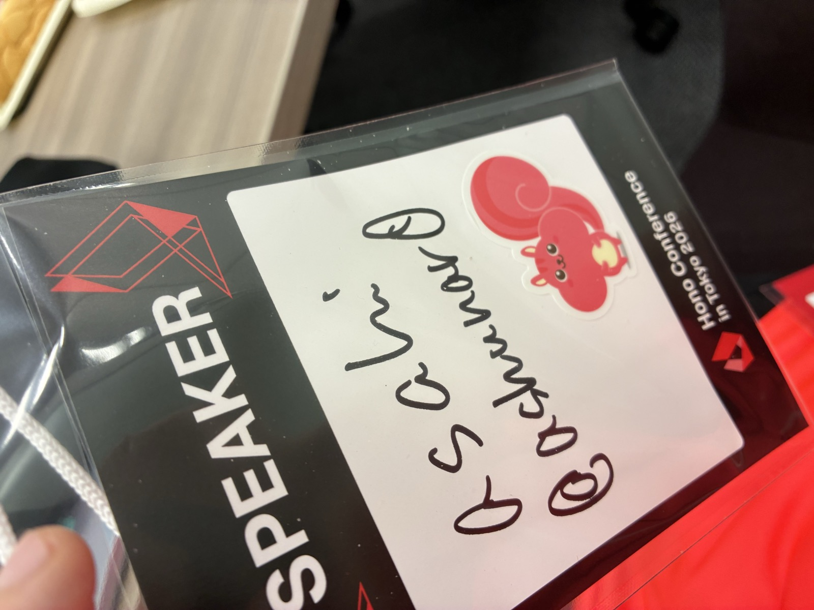
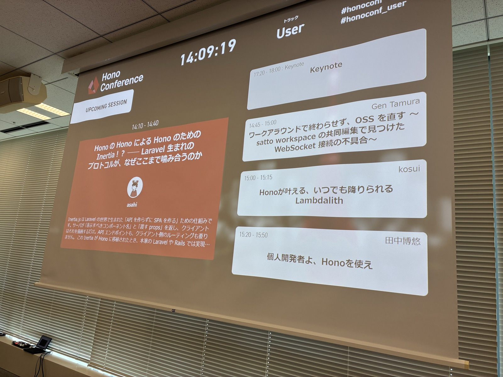
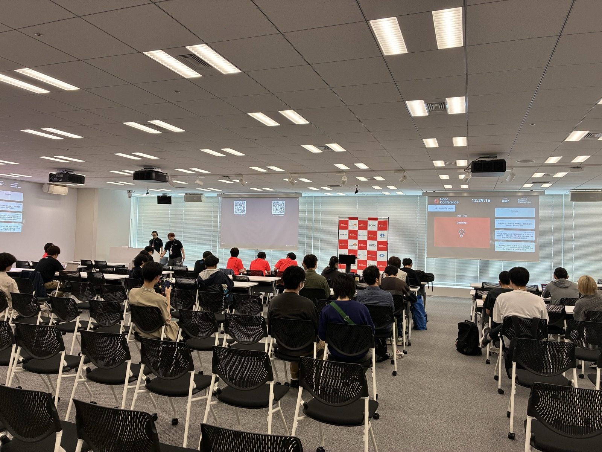
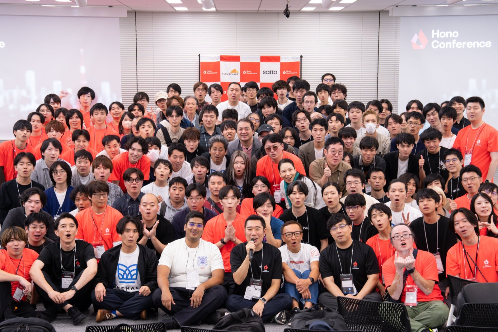

昨日、Hono Conf 2026 に参加してきました！！今回はセッションで登壇したのと、初めてスタッフとしても参加させてもらいました！！！結論から言うと、めちゃめちゃ楽しかったです！！

Hono の話はもちろん、アーキテクチャの話、FW の話、デザインの話、個人開発の話などなど、普段はできない超濃ゆい話がたくさんできてめちゃめちゃに幸せでした！！この興奮を忘れないうちにイベントレポートして残しておこうと思います！

## 登壇した話

今回は、「Hono の Hono による Hono のための Inertia.js!?」というタイトルで、30分のセッションをしゃべってきました！

https://speakerdeck.com/ashunar0/hono-no-hono-niyoru-hono-no-tame-no-inertia-js

そもそも Inertia.js ってなんぞや？っていう話と、それが Hono と出会ったことで何が起きたのか、っていう話をしました。（具体的な中身はスライドみてください！）

最初は30分って長いかなーと思ってたんですが、しゃべってみたら思ったよりあっという間でした！「あーこれ喋りたかったのに忘れてた」とか「ここもうちょい上手に喋りたかったな」っていう反省はあるんですけど、まあいちおう及第点かな？懇親会で何人かの方に発表を褒めていただけたのもとても嬉しかったです。こういう長いセッションにも、これからどんどん出ていきたいです！

## スタッフとして参加して

今回は初めてスタッフとしても参加させてもらいました！とはいえ、そんなに大層なことはしてなくて、ぶっちゃけ参加者として行くのとそこまで大きくは変わらなかったかも（笑）

でも、朝の準備から入ってみて、「このイベントってこんなにたくさんの人に支えられて成り立ってるんだな〜」っていうのはすごく感じました。朝早くからたくさんの人が集まっていろいろ動いてくれてるからこそ、参加者として行っても楽しいイベントになってるんですよね。スタッフのみなさん、本当にありがとうございました！とてもいい経験になりました。

## OST が面白かった

OST っていう、テーマに沿ってみんなで自由に議論する時間もあったんですが、これもめっちゃ面白かったです！テーマは「今後新しい FW は出てくるのか」とか「アーキテクチャ何使ってる？」とかいろいろあって、Hono に限らず、いろんな技術をがっつりやってるエンジニアの人たちばっかりなので、こういう場でみなさんとお話しできるのが本当に楽しかったです。

中でも面白かったのが、新しい FW は出てくるのかっていう議論です。

そもそもライブラリと FW の差ってどこなんだろうね？っていうところから話が始まったんですが、そこで出てきたのが「思想をどれだけ強制してくるか」っていう違いでした。

ライブラリって、使う側が能動的に呼び出して好きに使うものじゃないですか。関数を呼び出す感じに近いですよね。一方で FW は、書き方とかファイルの置き方とかをけっこうがっちり強制してきます。使う側はそれに受動的に乗っかる形になるので、名前の通り、まさに枠（フレーム）ですよね。

で、AI 時代になると FW に求められるものも変わってくるんじゃない？っていう話にもなりました。これまで FW が担ってた部分って、個人とかチーム単位でもできるようになるかもしれません。今までは、決まりを考えるのも大変だし、考えたものを作るのも大変でした。でも今は、AI がかなりやってくれます。

そうなると、Hono みたいな薄くて小さいライブラリ（Hono は FW なのかもしれないけど）を中心に置いて、その外側は各自が好きにやる、みたいな文化が増えるのかな〜と思ったりしました。Go もそれに近い文化がありますよね。

もちろん、Rails とか NestJS みたいに、規約がしっかりした既存の FW に乗っかって書く人もいます。

一方で、コードを見なくなったぶん、そもそもあんまり気にしない人も増えたよね、という話も出ました。一昔前は「どのアーキテクチャがいい」「どの FW がいい」みたいな議論がけっこういっぱいあったと思うんですけど、最近は少ないですよね。それって、コードそのものよりも、その周りの規約や要件を自然言語で決めて、そっちばっかり見るようになったからなんじゃないかなと。

そこから「そもそもコードをきれいに書く意味ってあるんだっけ？」っていう疑問も出てました。今までコードをきれいに書こうとしてたのは、あとで直すときに自分で読まなきゃいけなかったからなんですよね。でも AI がいたら、読んでいい感じに直してくれます。確かにその通りだよなーと思って、面白かったです。

自分はハーネスはきっちり作りたい派なんですけど、コードの美しさとか規約にそこまでこだわらない人も増えてて、「コードに真剣に向き合う人、減ったよね〜」っていう冗談まじりの声もありました（笑）

## 印象に残ったセッション

### 月間100万人のサービス刷新で、技術選定を Hono に振り切った話

https://speakerdeck.com/yutobara/gekkan-100-mannin-no-sabisu-sasshin-de-gijutsu-sentei-o-hono-ni-furikita-hanashi-e49c651f-8130-48bb-b6ef-eac3cc9f358a

bara さんの発表です。

実は自分も最近、規約とかジェネレーターとかを色々作ってて、大きいアプリにも対応できるように、AI に書かせても迷わないように、みたいなことを考えてるんですが、この発表でやってることがそれにすごく近かったんです！「あ、自分の考えってそんなに大きく間違ってはないんだな」って思えて嬉しかったです。（void が出る前にどこかで話したいなと思っています）

それに、これだけの規模のアプリを実際に Hono で動かしてる実例がある、っていうのがやっぱりめちゃくちゃ大きいですよね。自分の場合は勝手にやってるだけなので、実感も実例もないんですが（笑）、だからこそすごく参考になりました。自分もいつか、仕事のプロダクトで Hono を使いたいな〜！

### 個人開発者よ、Honoを使え

田中くんの発表です。なんと高校1年生！

学校の文化祭で Hono を使ってるそうで、文化祭のホームページも HonoX で作ったんだとか。すごくないですか？発表外でもいろいろお話しさせてもらえて、めっちゃ楽しかったです！また文化祭の話聞かせてね！

## 会場の雰囲気

全体的に、若い人がすごく多いな〜っていう印象でした。高校生も何人か来ていて、びっくりです。

とはいえ若い人ばっかりってわけでもなく、高校生から社会人の方まで年代が幅広くて、バランスもいいなと思いました。懇親会ではいろいろな方とお話しできました。

## yusukebe さんのキーノート

### Hono v5 が出るらしい！

最後は yusukebe さんのキーノート！なんと Hono v5 が出るそうです！！（時期ははっきり言ってなかった気がします）

v5 は、AI エージェントに Hono をどう使わせるか、ってところにすごくフォーカスしたバージョンになるそうです。これまでの Hono は人間が書く前提だったので、たとえば Hono RPC の補完がエディタでどれだけ速く出るか、みたいな人間の開発者体験を意識したものも多くありました。でも最近って、みんなあんまりコードを読まなくなってきてるじゃないですか。なのでこれからは、AI がどれだけ間違えずに、速く正確に書けるかを意識しないといけない、っていう話でした。AI 向けの DX ってやつですね。

具体的には、Hono CLI がアップデートされて、Cloudflare のテンプレートが新しい cf CLI を使うようになってたり、Hono のドキュメントをパッと引けるようになってたり。あと、eval（評価）が AI には欠かせない基準になる、みたいな話もされていたんですが、ここはまだ自分の中でよくわかってないのでこれからちゃんと勉強しようと思います。

改めて、時代が変わってきてるな〜っていうのをすごく感じました。自分も AI に Hono をどう書かせるかは普段からよく考えてるので、リリースが非常に楽しみです！

### 自分が関わった PR も紹介してもらえた！

キーノートでは、`defineHandler()` の PR の話も出てきました。yusukebe さんと X で話した流れでコメントさせていただいたやつです。

https://x.com/yusukebe/status/2108057552223359003

自分が関わったことをキーノートで紹介してもらえて、めちゃくちゃ嬉しかったです〜！Hono は外部からの PR は受付を停止しましたが、これまでとは違う形を模索しながら、今後も貢献していきたいなと思います！

## まとめ

Hono Conf 2026、一言で言うと、今まで参加したイベントの中で一番濃いイベントでした！！

次回もぜひ関わりたいです。というか絶対参加します！登壇ももちろんしたいですし、Hono Conf は今回から誰でも開催できるようになったみたいなので、機会があれば誰かと一緒に主催とかもやってみたいな〜なんて思ったりしてます。

最後になりますが、yusukebe さん、コアチームのみなさん、そして当日一緒に盛り上げてくれたみなさん、本当にありがとうございました！！

