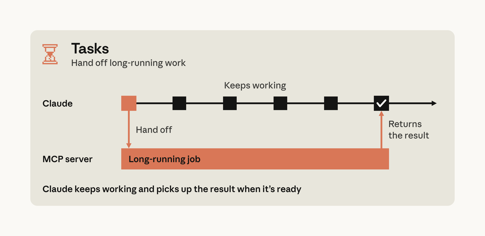
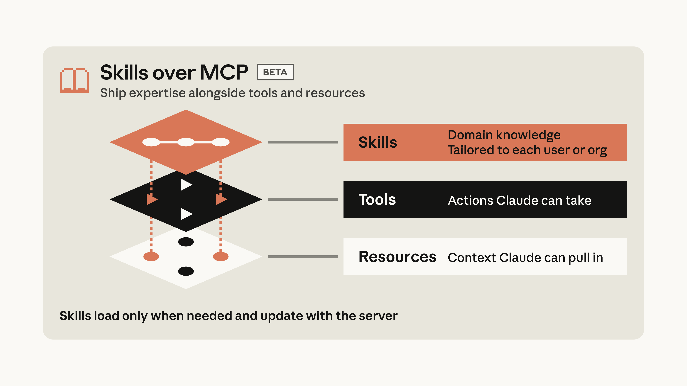

## はじめに

11 月 24 日に、Anthropic から MCP まわりのアップデートが発表されました。

https://claude.com/ja/resources/articles/skills-over-mcp-tasks-and-more

いくつか新しい機能が出ているのですが、中でも「Skills over MCP」がかなりよさそうだったので、今回はそれについてのお話です。

## 今回のアップデートの中身

まず最初に、発表された内容をざっくりまとめておきます。

- **Skills over MCP**：MCP サーバーが、ツールと一緒に「スキル」も配れるようになりました（パブリックベータ）
- **Tasks**：時間のかかる処理をサーバー側に任せて、その間に Claude は別の作業を進められます
- **Elicitation**：課金や削除のような操作の前に、サーバーがユーザーに確認を求められます
- **File Uploads**：PDF や画像などのファイルを、MCP サーバーに直接渡せるようになります（近日対応）

どれも便利そうですが、個人的に一番グッときたのは Skills over MCP でした。

## Skills over MCP とは

その前に、MCP とスキルの関係を軽くおさらいしておきます。

MCP は、Claude を外のサービスとつなぐための仕組みです。GitHub や Notion などにつなぐと、Claude がそこのデータを読んだり、操作したりできるようになります。

ただ、つながっただけでは「どう使えばいいか」まではわかりません。手がかりはツールの名前と説明くらいなので、細かいところは推測で動くことになります。

そこを補うのがスキルです。スキルは作業の手順やコツをまとめたマニュアルのようなもので、`SKILL.md` というファイルが中心になっています。

ここで困るのが、これまでスキルは自分で入れる必要があったことです。ファイルをダウンロードして、設定画面からアップロードして...と、地味に手間がかかります。そもそも「このサーバー用のスキルがある」と気づかないこともあったと思います。

Skills over MCP は、この部分を解決する仕組みです。MCP サーバーがスキルも一緒に配ってくれるので、サーバーにつなぐだけで使い方のマニュアルも付いてきます。

## 一番いいなと思ったところ

一番いいなと思ったのは、**スキルがサーバー側で更新される**ところです。

サービスに新しい機能が増えれば、マニュアルもそれに合わせて勝手に新しくなります。使う側は何もしなくて大丈夫です。

手元にスキルを置いておくやり方だと、どうしても古くなっていきます。サービスはどんどん変わっているのに、手元のマニュアルは昔のまま、ということが普通に起きるんですよね。

これを気にしなくてよくなるのは、結構大きいと思っています。

もう一つ、スキルは必要なときだけ読み込まれます。最初は名前と説明くらいしか見ないので、たくさんのサーバーにつないでいても、そのせいでコンテキストがいっぱいになることはありません。

## 使われている例

元記事では、こんな例が紹介されていました。

- **Shopify**：ネットショップの立ち上げや更新を、最初から最後まで手伝ってくれます
- **HubSpot**：顧客のオンボーディングや、Claude でのセットアップを手伝ってくれます
- **Atlassian**：組織の状況をふまえて、作業の分析をしてくれます

どれも「ツールはあるけど、どういう順番で使うかが大事」なタイプの作業ですね。こういう作業こそ、手順をまとめたスキルがあると助かりますね。

## 仕組みを少しだけ

中身は意外とシンプルです。

1. スキルの形式は、これまでと同じ `SKILL.md` と補助ファイルの組み合わせ
2. それを MCP の「リソース」として公開する
3. クライアントは `skills/list` で一覧を取って、`skills/get` で個別のスキルを取ってくる

MCP 側はスキルの中身を特別扱いしておらず、ただのリソースとして運んでいるだけです。このあたりの割り切り方はいけてそうだなと思いました。

## どこで使えるか

Claude と Claude Code で使えます。

| プラン | 状況 |
|---|---|
| Pro / Max / Ultra | 最初からオン |
| Team | 管理者が有効にすれば利用可能 |
| Enterprise | 近日対応予定 |

## 最後に

MCP でサービスにつなぐところまでは、もうだいぶ当たり前になってきた印象です。これからは「つないだあと、ちゃんと使いこなせるか」が大事になっていくと思います。

Skills over MCP は、そこをサービスを作る側がまとめて面倒を見られるようにする仕組みです。派手さはないですが、使い続けるほどありがたさがわかるアップデートだと思っています。

ということで、Skills over MCP の紹介でした！対応するサーバーが増えてきたら、また触ってみたいと思います。
